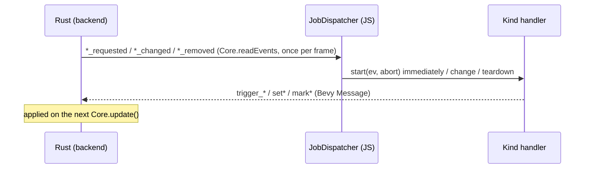

# Frontend Job Protocol

How the Rust core and a rendering frontend split async work: the backend
(Rust) decides what runs, when, and how much; the frontend (Three.js today)
runs fetches, worker-pool tasks and mesh builds and reports back. For the
surrounding architecture see [ARCHITECTURE.md](ARCHITECTURE.md); for memory
budgets and the load gate see [MEMORY_MANAGEMENT.md](MEMORY_MANAGEMENT.md).

## Overview

The backend owns state and every scheduling decision and never runs async
work (no futures, no executors). The frontend owns I/O and GPU resources and
makes no scheduling decision of its own: it keeps no queue, no cap and no
priority order.

Each frame `Core.update()` runs the ECS schedule; systems push entity ids
into `EventStore`; `Core.readEvents()` materializes them into an owned
`Events` object; `JobDispatcher.tick()` consumes every stack of it in the same
frame (nothing is carried over). Reports only write a Bevy `Message`, so the
frontend never mutates the World re-entrantly.

## Event contract

A kind that needs async work on the frontend emits three events:

| Event                                     | When                                      | Payload                        |
| ----------------------------------------- | ----------------------------------------- | ------------------------------ |
| `*_requested` / `*_added` / `*_delegated` | the backend admitted the work             | everything the job needs       |
| `*_changed` (optional)                    | the entity's state changed while it lives | a full snapshot, never a delta |
| `*_removed`                               | the entity is despawned                   | id only                        |

`*_removed` is emitted at the despawn point, unconditionally, including
while the job is still in flight; there is no separate cancel event. The
backend ignores reports for entities it already despawned: a worker result's
buffers are freed, a failure is a no-op, a load matches no `Requested`
requester. The exception: several pipelines despawn a data requester whose
fetch already settled without a `data_requester_removed` event.

The kinds are registered in `registerEventHandlers`
(`web/navara_three/src/event/index.ts`): tile meshes, delegated worker
tasks, renderable features, texture fragments and data requests as jobs;
kinds without async work (camera, transforms, `vector_drape_changed`, ...)
through `registerSync`, which run first in each tick.

## JobDispatcher

`web/navara_core/src/event/JobDispatcher.ts`. One job table per kind, keyed
by entity id. Per tick and kind it takes `removed`, `requested` and
`changed`, then:

| Event     | No job                    | Job in flight (`start` or a `change` running) | Job live (settled)                 |
| --------- | ------------------------- | --------------------------------------------- | ---------------------------------- |
| requested | `start(ev, abort)` now    | ignored (same entity)                         | ignored (same entity)              |
| changed   | dropped                   | kept as the one pending change (latest wins)  | `change(product, ev)`              |
| removed   | `teardown(undefined, ev)` | `abort()`; teardown once the call settles     | `abort()`, `teardown(product, ev)` |

A `requested` and a `removed` for the same entity in one tick cancel out:
`start` is never called. When an in-flight call settles, a pending `removed`
wins over a pending change; otherwise the pending change is applied, so calls
on one job never overlap. `start` rejecting (or throwing) calls the kind's
`failed(ev, error)` unless the job was removed or the dispatcher disposed
(an abort the handler fires on its own signal still reports); resolving
`undefined` means "done, no product". A job that settles without a product
(or whose `start` failed) leaves the table, so the data requesters despawned
without `removed` (see Event contract) do not leak. `dispose()` aborts
everything and tears late products down with `ev === undefined`.
`inFlight()` counts jobs with a call outstanding and is O(1).

**Event ownership.** The dispatcher frees every WASM event object it takes:
sync events right after their handler, `requested` / `changed` events when
the call that received them settles, `removed` events after `teardown`.
Handlers may read an event across their own awaits and never call `free()`
on one. A wasm-bindgen getter returns a new owned wrapper on every read, so a
nested payload (`event.task`, `event.feature`) is read once and what is not
handed on is freed.

## Handler rules

1. **Check the signal after every `await`.** Once `abort.signal.aborted` is
   set, skip state-writing reports (`set*`, `mark*`, buffer-store writes)
   and drop what was built. A late `setU8` would re-insert a handle the
   backend already freed.
2. **Worker-task delegators always settle.** `runDelegatedWorkerTask`
   (`workerTaskSettlement.ts`) reports `triggerWorkerTaskCompleted` or
   `triggerWorkerTaskFailed` on every path, aborted included: an unsettled
   delegator would hold a worker budget slot forever, and the backend frees a
   late result's buffers itself. Pool promises go through
   `settleWorkerTask(signal, promise)` so an abort cancels them.
3. **Index by identity.** Jobs are independent; no order is guaranteed
   between entities. A new entity sharing a tile handle or URL with an old
   one may be requested before the old one is removed, so a cache keyed by
   such a handle (`tileMapByHandle`, `textureFragmentIndex`, `meshes`) is
   deleted from only when it still holds this job's object.
4. **Teardown handles a failed `start`.** `start` may have indexed or added
   its object before throwing; `processObjectRemoved` falls back to the
   indexed object when the product is `undefined`. An object that acquired
   resources without being indexed (a `TileMesh` registers its handle and
   atlas in its constructor) is released by `start` before it rethrows.

## Admission on the Rust side

### Fetches

Each fetch pipeline (raster fragments, terrain DEM, vector tiles, 3D Tiles
content, hillshade DEM) caps its in-flight requesters at
`RequestLimits.max_pendings` (`Core.setMaxPendingRequests`), sorted by
`Priority` and distance, behind the memory load gate. `data_requested`
carries the rank as `priority`; the frontend starts every fetch at once and
passes it on as the browser's fetch priority hint.

### Shared worker budget

All delegated worker task kinds draw from one budget (`navara_worker`):

- `WorkerLimits.max_pendings` is set by the frontend to two tasks (one
  running, one queued) per pool worker that takes tasks
  (`Core.setMaxWorkerTasks`, re-sent by `ThreeView._syncWorkerPool` when it
  changes): workers reserved for threads outside the pool (see Worker pool)
  take none.
- `compute_worker_budget` sets `WorkerBudget.shared` to the limit minus the
  live delegatees (`DelegatedWorkerTaskMarker`, not `Deleted`) and minus
  `WorkerLimits.external_load`. A delegatee whose delegator no longer exists
  is marked `Deleted` there instead of counted, so a delegator despawned
  outside `remove` cannot leak a slot.
- `external_load` is the pool work outside delegated tasks: image decodes of
  `data_requested`, Draco, descriptor and plugin tasks, and tasks cancelled
  while running. `ThreeView._syncWorkerPool` reports it before each
  `Core.update()` (`Core.setWorkerExternalLoad`) as the pool's load
  (`RecyclingWorkerPool.load`) minus the delegated-task jobs in flight, each
  of which holds one pool task. A burst of such work holds delegation back
  until it drains instead of queueing the next terrain mesh behind it.
- A kind is identified by its marker component (`ParseMvtTileMarker`, ...),
  carried by both delegator and delegatee.
  `reserve_for_starving_kind::<M>` runs once per kind in priority order and
  reserves one slot of `shared` for a kind that has waiting tasks and none
  in flight. The kind systems then delegate in the same order — terrain
  mesh, upsample, MVT parse, polygon, polyline — each taking its reserved
  slot first and then from `shared`, nearest first (`OrderByDistance`).
  The total never exceeds the limit, and no kind starves behind a steady
  stream of the kinds before it; the cost is that a reservation can take a
  slot the terrain mesh would otherwise have had.
- Both passes are generated from one list in `WorkerPlugin`
  (`delegate_by_priority!`, one `marker => system` line per kind), so a new
  kind is added in one place and its priority is the line's position. A
  marker listed twice panics while the plugin builds.
- `commit` emits a frame's new delegations sorted by `Priority`, so the pool
  queue receives them most urgent first.

A delegatee marked `Deleted` (cancelled) leaves the budget at once, while a
task cancelled mid-run keeps its worker until it finishes; it is counted
again through `external_load` from the next frame, so no cancel
acknowledgement is tracked.

### Pausing intake

`RecyclingWorkerPool` recycles a worker once its WASM heap exceeds the
budget, but only at a task boundary. While every unreserved slot is
draining (`RecyclingWorkerPool.canAcceptTasks()`),
`ThreeView._syncWorkerPool` sets `WorkerLimits.intake_paused`
(`Core.setWorkerIntakePaused`, the resource lives in
`navara_worker_component`). Until a recycled worker is back, everything
that would put work on the pool is held back:

- `WorkerBudget.paused` stops all delegation, reservations included.
- `navara_feature`'s `commit` holds back model features'
  `renderable_feature_added` (`DeferredFeatureAdd`), since building a model
  decodes Draco on the pool.
- `navara_data_requester` holds back the `data_requested` of an image fetch
  leader (PNG / WebP, decoded on the pool), new or promoted
  (`DeferredDataRequest`); it keeps `Requested`.

Pool work started by descriptors or plugins directly, and by jobs already
running, is not paused.

### Shared fetch leader

Consumers asking for the same URL and byte range share one handle and one
fetch (`DataManager`). The consumer whose fetch was dispatched is the
`leader`; the others wait with `Requested` and no event. The invariants:

- The leader is cleared when the fetch succeeds or fails, so a later
  consumer that finds no buffer dispatches again.
- When the leader is removed while consumers remain, its key is recorded as
  orphaned. `promote_fetch_leaders` runs in `PostUpdate` after the load and
  fail systems and makes one consumer that is alive, `Requested` and
  `Pending` the new leader, re-emitting `data_requested` for it. The
  frontend has aborted the old fetch on its `removed`; the new one usually
  hits the browser cache. A key with no such consumer is dropped.
- Load and failure reports carry the handle
  (`triggerDataRequesterLoaded(bits, handle)`,
  `triggerDataRequesterFailed(bits, handle)`), so a result lands on every
  waiting consumer even when the reporting entity is already gone. Handles
  are never reused, so this cannot reach an unrelated fetch.

## Worker pool

`@navaramap/worker` runs tasks on a `RecyclingWorkerPool`: one single-worker
workerpool per slot, so each worker recycles on its own. A new task goes to
the least-loaded non-draining slot, where load is the larger of the slot's
own in-flight count and the worker's busy plus queued count: a task
cancelled while running drops from the former at once but keeps the worker
busy until it ends. A task cancelled while queued costs nothing; workerpool
skips it when it reaches the front.

`ConcurrencyManager` counts the pool's in-flight tasks (`queueTask`
increments and decrements it), oversubscription included, and its `total`
is the pool size. Plugins read it through `ViewContext.concurrencyManager`
(`total`, `actives`, `idles`) and cannot change it.

A thread outside the pool (the font worker while it loads fonts or shapes
text, Spark's workers while a splat loads) holds a core with
`reserveWorkerCore()` (`ViewContext.reserveWorkerCore()` for descriptors
and plugins, `FontManager.setWorkerCoreReservation` for the font worker)
and releases it when its work ends. A package other than
`@navaramap/three` must be handed the function rather than import it: each
package bundles its own copy of `@navaramap/worker`, whose pool state is
then a different, uninitialized one. The font worker keeps its core
100 ms past its last request so a burst does not flip it per request. Each
reservation takes one slot of `RecyclingWorkerPool` off new tasks (the
least loaded one, which frees soonest), so its worker idles once its queued
tasks finish; at least one slot always keeps taking tasks. Lowering the
engine's budget alone would free no core: with two tasks per worker, the
rest would still keep every worker busy.

## Idle

`ThreeView` emits `idle` once `idleThreshold` ms pass with no engine events
and no job in flight (`JobDispatcher.inFlight()`), counted from the later of
the last events and the last busy frame. Fetches have no timeout and some
jobs wait on resources that may never arrive, so in-flight jobs stop counting
as busy once `inFlight()` has not changed for `STALLED_JOBS_MS` (10 s);
otherwise one hung request would keep `idle` from ever firing.

## Known limits

- **Per-frame bursts.** Any cap belongs on the emitting side.
  `navara_feature`'s `commit` spends a budget of
  `FEATURE_ADD_BUDGET_PER_FRAME` (24) units of `renderable_feature_added`
  per frame (a model costs 8, any other feature 1) and holds the rest back
  (`DeferredFeatureAdd`), releasing them in the order they were held back:
  a REPLACE 3D Tiles parent stays until all its children are rendered, so a
  starved early add would hold coarse tiles on screen. `mesh_added` is not
  capped: the tile traversal bounds how many meshes one frame activates, and
  a swap waits on every mesh it names.
- **Timeouts.** Only image loads (`AbortableImageLoader`, texture
  fragments) carry a deadline; it fails the job after 5 s so a server that
  never answers cannot hold `idle` back. Data requests have none: a slow
  server is waited for, and only the backend's `*_removed` (or the
  browser's own network error) ends the request.
- **Steps that cannot be aborted.** Draco decoding inside
  `GLTFLoader.parseAsync`, glTF texture decoding and font loads ignore the
  job's signal. A cancelled model or text job stays in flight until the load
  ends and then drops its product.
- **Unmetered pool use.** Work outside delegated tasks is counted only after
  it reached the pool (`external_load` is a snapshot from the frame start),
  so a frame's own image decodes and Draco tasks can run the pool a few
  tasks deeper than the limit until the next frame.
